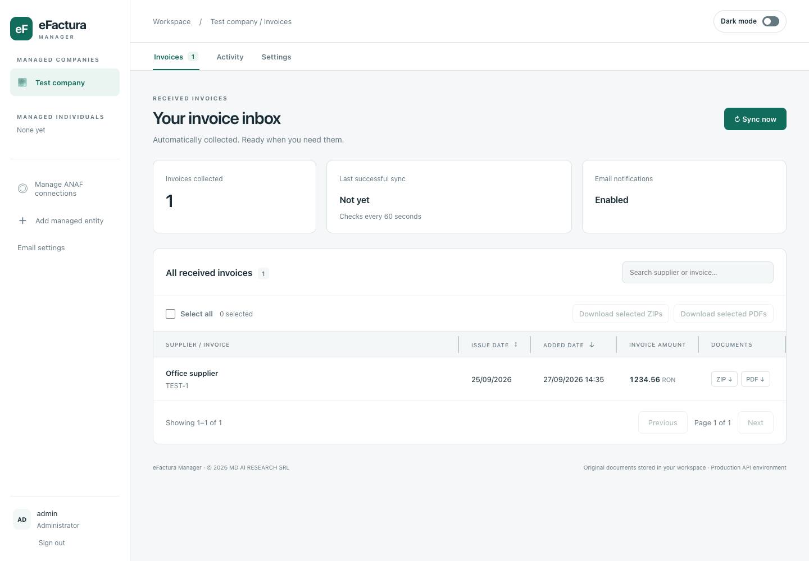

# eFactura Manager

[](https://github.com/sakuntalle/eFacturaManager/actions/workflows/ci.yml)
[](LICENSE)

eFactura Manager collects your received Romanian e-Factura invoices from ANAF (Romania’s National Agency for Fiscal Administration) and keeps them in one place. Run it on your own computer, open it in a browser, and manage invoices for multiple companies or individuals.

## What you can do

- Automatically collect received invoices for each authorized company or individual.
- Search invoices, inspect their details, and sort by issue date or the date added by ANAF.
- Download original invoice ZIPs and generated PDFs, individually or in bulk.
- Keep separate invoice archives, synchronization schedules and notification settings for each entity.
- Get email notifications for new invoices and inspect background work in **Activity**.



*The screenshot uses synthetic example data.*

**Project status:** actively developed. Live ANAF authorization and invoice retrieval work with real company invoices. The current version focuses on received e-invoices; company fiscal messages and outgoing invoice generation are in progress on separate branches. See the [roadmap](ROADMAP.md).

One administrator manages the whole workspace; separate viewer accounts are not available. By default, the app is accessible only from the computer running it.

[Install](#install-a-release-non-developers) · [Use the app](#use-the-app) · [Updates and backups](#updates-and-backups) · [Development](#development)

## Before you start

You will need:

- **Docker Desktop**, or Docker Engine with Compose v2, running Linux containers. The published images support `linux/amd64` (64-bit Intel/AMD) and `linux/arm64` (64-bit ARM, including Apple Silicon). Native Windows containers and 32-bit systems are not supported.
- **Locally trusted HTTPS certificates**, created using the [local HTTPS setup](docs/local-https.md).
- **For collecting invoices:** an ANAF application registration and a qualified certificate authorized to access the relevant company or individual. The registration supplies the client identifier, client secret and registered callback URL. See [ANAF connection setup](docs/live-connection.md).
- **For email notifications and password recovery:** an SMTP server account. Configure it in the app after signing in.

You can install the app and sign in before authorizing ANAF. The inbox remains empty until an entity is linked to an authorized connection and synchronization runs.

## Install a release (non-developers)

This is the recommended path for using the app. It downloads a ready-built image from the public [GitHub Container Registry package](https://github.com/sakuntalle/eFacturaManager/pkgs/container/efactura-manager); Git, Node.js, npm and a source checkout are not required.

1. Install and start Docker Desktop, or Docker Engine with Compose v2.
2. Create an empty installation folder. From the [latest release](https://github.com/sakuntalle/eFacturaManager/releases/latest), download `compose.yaml`, `compose.release.yaml` and `env.release.example` into it. Keep both Compose files together.
3. Rename `env.release.example` to `.env`. Keep the release's `EFACTURA_VERSION` value and set `POSTGRES_PASSWORD` to a random password. You can generate one with:

    ```sh
    docker run --rm node:24-alpine node -e "console.log(require('node:crypto').randomBytes(32).toString('base64'))"
    ```

4. In `.env`, enter your ANAF application's `ANAF_CLIENT_ID` and `ANAF_CLIENT_SECRET` when available. The default app address is `https://localhost:8765`; the exact registered OAuth callback must match `https://localhost:8765/callback`. Follow the [ANAF setup guide](docs/live-connection.md) if your registration uses another address or port.
5. Create the private administrator folder:

    ```sh
    mkdir -p .local/admin
    ```

    In Windows PowerShell, use `New-Item -ItemType Directory -Force .local/admin` instead.

6. Follow the [local HTTPS setup](docs/local-https.md) to create and trust `.local/tls/localhost.pem` and `.local/tls/localhost-key.pem` before starting the web app.
7. Run these commands from the installation folder:

    ```sh
    docker compose --env-file .env -f compose.release.yaml pull
    docker compose --env-file .env -f compose.release.yaml up -d database
    docker compose --env-file .env -f compose.release.yaml --profile tools run --rm admin-bootstrap
    docker compose --env-file .env -f compose.release.yaml up -d --wait
    ```

8. Open <https://localhost:8765>. Sign in as `admin` using the generated temporary password in `.local/admin/README.md`, then change it when prompted.

The database password is chosen during setup. The app generates its session and encryption keys automatically and stores them in the private `app-secrets` Docker volume. Keep `.env`, `.local` and backups private.

The [Docker installation guide](docs/docker-desktop.md) has further platform-specific details. To build a source checkout instead, follow the [development guide](docs/development.md#docker-development-build).

## Use the app

### Connect your first company or individual

A fresh installation opens **Manage ANAF connections** and starts with no entities or authorizations.

1. Create a named ANAF connection.
2. Open **Add managed entity**, select Company or Individual, and enter its name, fiscal identifier (CIF/CUI for a company or CNP for an individual), notification email and ANAF connection.
3. Return to **Manage ANAF connections**, choose **Connect** for that connection and complete authorization with the appropriate qualified certificate.
4. When the browser returns to the app, select the entity in the sidebar. Initial synchronization starts in the background. Check **Activity** for progress, or use **Sync now** to request another synchronization.

One authorization can serve multiple entities when the certificate has access to their fiscal identifiers. Adding an entity in the app does not grant that access. The initial import does not send a separate notification for every historical invoice.

### Browse and download invoices

Select an entity under **Managed companies** or **Managed individuals**, then use:

- **Invoices:** search by supplier or invoice number, open a row for details, and download its original ZIP or generated PDF. Date headings change the sort order. **Select all** can select matching invoices across pages for a bulk download.
- **Activity:** follow synchronization, PDF generation and email delivery. Failed tasks can be retried here.
- **Settings:** change the entity's polling interval, notification recipient or linked ANAF connection.

Each entity has its own archive and settings. Deleting an entity in **Settings** permanently removes its stored invoices, documents and activity after confirmation.

### Enable email notifications

1. Open **Email settings** in the sidebar. Enter your SMTP host, port, TLS settings, username, password and sender address, then save.
2. Open the entity's **Settings**, choose its **Notification email** and enable **Send E-invoice notification emails**.

The SMTP sender is shared by all entities; recipients and notification switches are per entity. Email is optional for collecting and viewing invoices. Anyone who controls a configured notification mailbox can reset the shared administrator account, so use trusted recipients.

Use **Forgot password?** on the sign-in page for email recovery. It requires configured SMTP and an email address saved on an entity. See [account recovery and troubleshooting](docs/operations.md#administrator-access-and-recovery).

## Updates and backups

Back up the PostgreSQL database and the `app-secrets` volume together. They hold your invoice data, documents, settings and the keys needed to use encrypted settings. Restarts and image updates preserve these volumes.

Before updating, read the release notes and change `EFACTURA_VERSION` in `.env` to the desired release number. Then run:

```sh
docker compose --env-file .env -f compose.release.yaml pull
docker compose --env-file .env -f compose.release.yaml up -d --wait
```

To stop the app while retaining its data:

```sh
docker compose --env-file .env -f compose.release.yaml down
```

`docker compose down -v` permanently deletes the database and application-secrets volumes. See [operations and troubleshooting](docs/operations.md) for diagnostics, recovery and older-installation migrations. Collection is not a complete historical backfill or archival service; retain your own backups.

## Development

The app uses TypeScript, NestJS, React, PostgreSQL and pg-boss. The [development guide](docs/development.md) covers cloning the repo, native development, source Docker builds, automatic image rebuild detection and test commands. The [architecture guide](docs/architecture.md) explains component boundaries and background delivery behavior.

Automated connection tests use simulated ANAF responses over real local HTTPS and PostgreSQL. They exercise browser interactions without contacting ANAF; real qualified-certificate authorization remains a separate manual check.

## Contributing, security and license

See [CONTRIBUTING.md](CONTRIBUTING.md) for contributions and [SECURITY.md](SECURITY.md) for private vulnerability reports. Planned features are tracked in [ROADMAP.md](ROADMAP.md). Maintainer release instructions are in [docs/releasing.md](docs/releasing.md).

Copyright © 2026 Mihnea Magheru. Licensed under the [BSD 3-Clause License](LICENSE). The software is provided without warranty.
